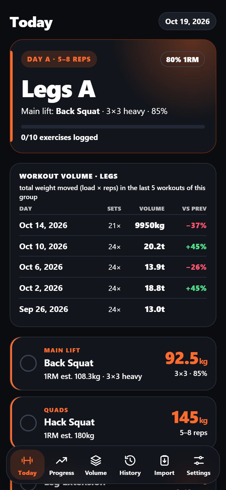
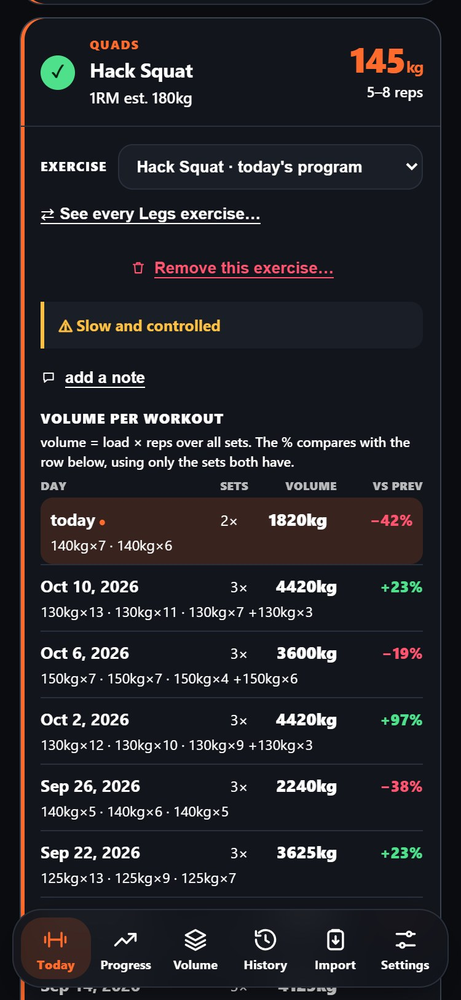
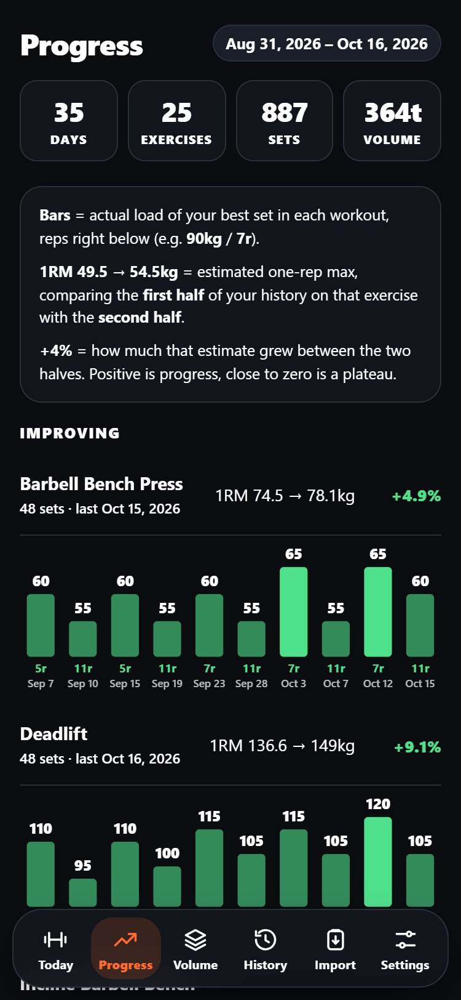

# ppl-tracker

The workout tracker I use at the gym. It's built around how I actually log training: a messy note in iPhone Notes, in Portuguese, a year long. The app parses that notebook, suggests today's loads from the history and logs the session.

<p>
  
  
  
</p>

- Push/Pull/Legs twice a week. A days are heavy (5-8), B days are volume (10-15). The cycle moves when a workout is finished, not by calendar, so an extra rest day doesn't skip anything.
- Target loads come from the estimated 1RM (Brzycki, best set of the last 8 weeks), capped at +10% over the heaviest load actually lifted on that exercise.
- The importer survives five spellings of the same exercise, typo dates (`01/12` in the middle of February), drop sets, rest-pause, "7 e 3" sub-sets and plates instead of kg.
- Volume is compared at equal set counts, so doing one extra set doesn't show up as progress.
- Two phones stay in sync through a private GitHub repo (Contents API, no server). Merges are per day, by timestamp, with tombstones for deleted days.
- Plain HTML + ES modules. No framework, no dependencies, no build step to run it.

## Run

```
python -m http.server 4173
```

Open http://localhost:4173, go to **Import** and paste `test/sample-history.txt` (synthetic data in the same format as my notebook, not my log).

`node build.mjs` writes a single self-contained `ppl-tracker.html`, which is what lives on my phone for offline use.

## Tests

```
node --test
```

## Notes

- The importer's vocabulary is Portuguese on purpose, it exists to read my notes. Common English gym terms map into it (bench press, lat pulldown, skull crusher, leg press...). Ids and history keep the Portuguese words; `js/names.js` only translates what's printed, otherwise sets logged in the app and imported ones would end up in two histories.
- Everything is stored in `localStorage`. Sync needs a fine-grained token with Contents read/write on **one** private repo; the app refuses to sync to a public one.
- `_headers` is the CSP used on Cloudflare Pages. With it, the only place the page can send data to is api.github.com.
